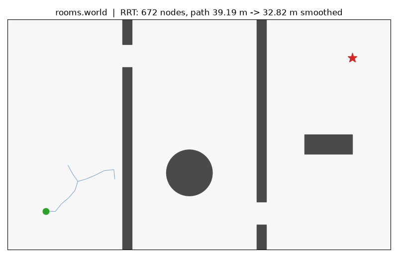
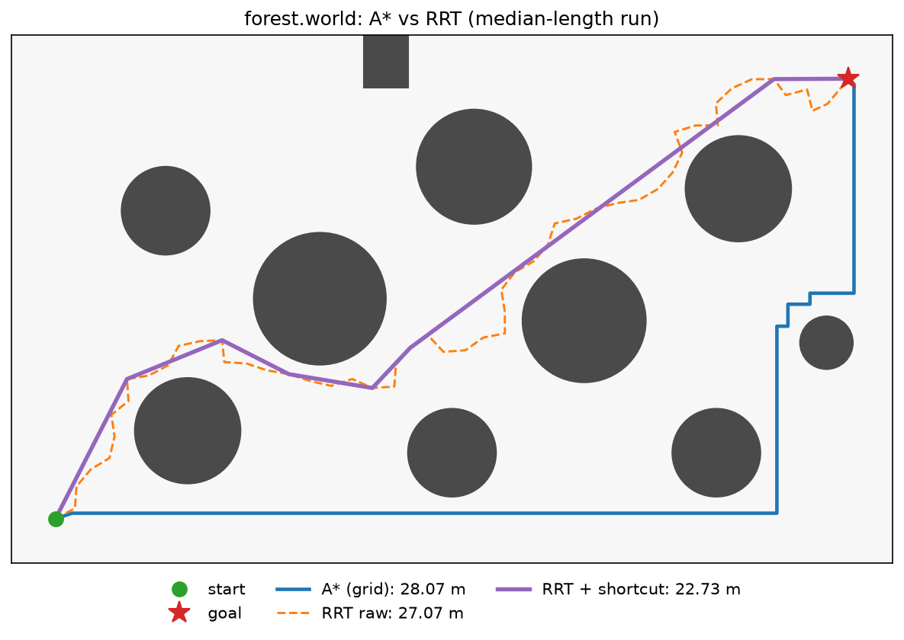
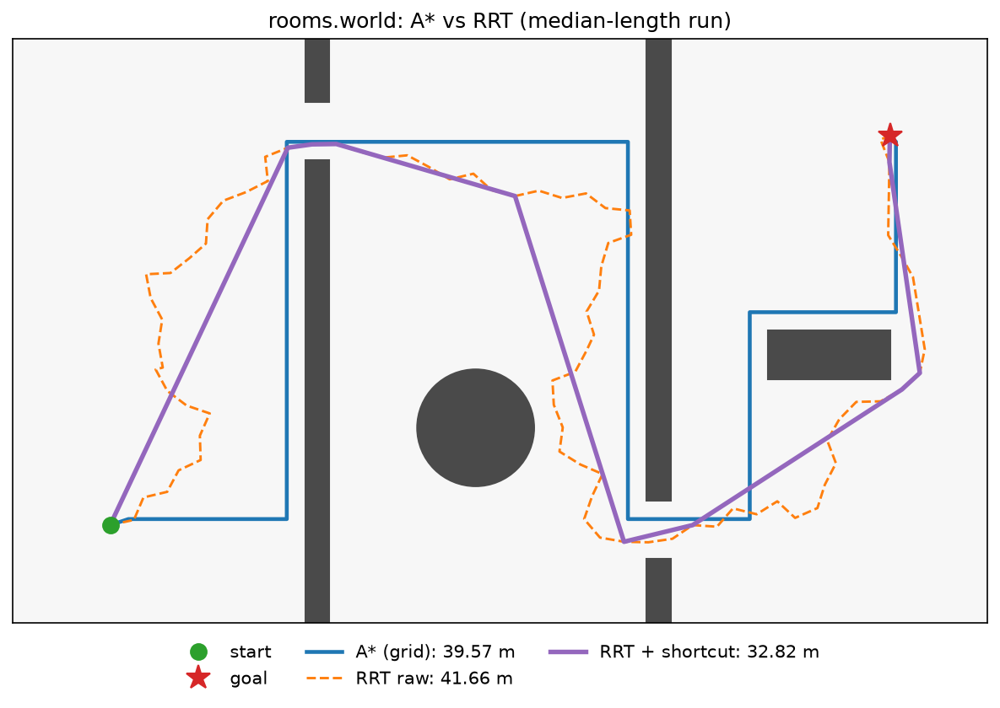

# Drone Autonomy Simulator


A 2D drone autonomy simulator built from scratch in **C++17**, with Python visualization.
The drone plans routes through grid and continuous obstacle maps with A* and RRT,
with point-mass dynamics and exact collision checking. Next up are path following
with a PID controller and reactive obstacle avoidance.

The focus is clean, tested, interview-grade implementations of core robotics
algorithms rather than wrapping existing libraries.

## Results

### A* on a grid

A* finds the optimal 36-move route through a 21×13 maze (4-connected, unit cost):


### RRT in continuous space

RRT grows a tree from the start by sampling random points in free space, with a
5% bias toward the goal. Every edge is collision-checked exactly for a 0.3 m radius
drone. In `rooms.world` the drone has to get through two 1.2 m doors, which is the
classic hard case for uniform sampling.

The raw RRT path (orange) is jagged. Random shortcutting then repeatedly picks two
waypoints and, if the straight segment between them is collision-free, drops
everything in between (purple):



### RRT vs A*

All planners run on the same world. A* searches a 0.25 m grid rasterized from the
continuous map, with obstacles inflated by the drone radius. RRT plans directly in
continuous space (0.5 m step, 5% goal bias), and each path is then shortcut for 200
rounds. RRT results are over 50 seeds.

| Map | Planner | Success | Path length (m), median (range) | Time (mean) |
|---|---|---|---|---|
| `forest.world` | A* (grid) | 1/1 | 28.07 | 0.04 ms |
| | RRT raw | 50/50 | 27.06 (23.37–31.97) | 0.09 ms |
| | RRT + shortcut | 50/50 | **22.98** (21.07–26.85) | 0.10 ms |
| `rooms.world` | A* (grid) | 1/1 | 39.57 | 0.04 ms |
| | RRT raw | 50/50 | 41.50 (37.91–47.93) | 0.66 ms |
| | RRT + shortcut | 50/50 | **32.82** (31.44–36.65) | 0.67 ms |

Release build on an Apple M5 Pro. A* time excludes the one-off rasterization
(~0.03 ms), and the smoothed time includes RRT. Reproduce with
`compare_planners <map> --runs 50`.

The figures show the run with the median raw length:

| `forest.world` | `rooms.world` |
|---|---|
|  |  |

Takeaways:

- **Shortcutting is nearly free and makes the biggest difference.** It adds about 0.01 ms, cuts the median path by 15% (forest) and 21% (rooms), and reduces hundreds of tree nodes to 6–8 waypoints. A path that sparse is also much easier for a controller to follow.
- **Smoothed RRT beats grid A\* on length.** It's 18% shorter in `forest` and 17% shorter in `rooms`, because A\*'s 4-connected moves form a staircase while shortcut segments can take any angle. A\* is only optimal on its own grid.
- **RRT still pays for narrow passages.** In `rooms` it needs about 2.3x the nodes and 7x the time it needs in `forest`. Smoothing also narrows the seed-to-seed spread (38–48 m raw down to 31–37 m), but it can't fix a path that went through the wrong door.
- **All of them are sub-millisecond at this scale.** A\*'s cost grows with grid resolution and map area, while RRT's grows with how hard the free space is to sample.

## Features

- **Grid world:** occupancy grid loaded from a plain-text map format, with strict validation (ragged rows, unknown characters, missing or duplicate start/goal).
- **A\* path planning:** 4-connected search with a Manhattan heuristic, a binary-heap open set, lazy deletion of stale entries, and flat `g`/parent arrays for cache-friendly lookups.
- **Continuous world:** circular and axis-aligned rectangular obstacles in meters, loaded from a `.world` text format with line-numbered errors.
- **Collision checking:** the drone is a disc. Point and swept-segment checks against circles, rectangles and bounds are exact (closed-form, no sampling), so thin walls between two free points are never missed.
- **Drone dynamics:** point mass with max speed and max acceleration, integrated with semi-implicit Euler.
- **RRT:** sampling-based planning in continuous space with goal biasing, seeded and fully reproducible.
- **Path smoothing:** random shortcutting that removes unnecessary RRT waypoints while staying collision-free.
- **A\* vs RRT:** the continuous map is rasterized (obstacles inflated by the drone radius) so both planners run on the same world, then compared on path length, success rate, and runtime over many seeds.
- **CLI:** `plan_path` (A* on grid maps), `plan_rrt` (RRT plus shortcutting, exports tree and paths), `compare_planners` (benchmark table).
- **Visualization:** matplotlib scripts for grid worlds, an animated GIF of RRT tree growth and smoothing, and an A*/RRT overlay.
- **Testing:** 76 GoogleTest unit tests for parsing, collision geometry, dynamics, RRT and smoothing invariants, and A*, including optimal-length checks against BFS.
- **CI:** GitHub Actions builds and runs the tests on every push.

## Build and run

Requirements: CMake ≥ 3.16, a C++17 compiler, Eigen 3, and Python 3 with matplotlib.
GoogleTest is fetched automatically by CMake.

```bash
# Dependencies
#   macOS:  brew install cmake eigen
#   Ubuntu: sudo apt install cmake libeigen3-dev
pip install matplotlib

# Build and test
cmake -S . -B build
cmake --build build -j
ctest --test-dir build --output-on-failure

# Plan a path and plot it
./build/plan_path maps/maze.txt build/path.csv
python3 viz/plot_world.py maps/maze.txt build/path.csv -o maze.png
```

`plan_path` exits with `0` if a path is found, `2` if there's no path, and `1` on bad input.

### Continuous planning (RRT)

```bash
# Plan with RRT and animate the tree growing
./build/plan_rrt maps/rooms.world build/rrt --seed 1
python3 viz/animate_rrt.py maps/rooms.world build/rrt -o rrt.gif --png rrt.png

# Compare A* (rasterized) and RRT over 20 seeds; use a Release build for timings
./build/compare_planners maps/rooms.world --runs 20 --out build/compare
python3 viz/plot_compare.py maps/rooms.world build/compare -o compare.png
```

`plan_rrt` options: `--seed`, `--step`, `--goal-tol`, `--goal-bias`, `--max-iters`, `--smooth-iters`.
`compare_planners` options: `--res` (A* cell size, m), `--runs`, `--max-iters`, `--smooth-iters`, `--out`.

### Map format

One character per cell. All rows have the same width, and blank lines are ignored.

| Char | Meaning             |
|------|---------------------|
| `.`  | free                |
| `#`  | obstacle            |
| `S`  | start (exactly one) |
| `G`  | goal (exactly one)  |

`x` is the column and `y` is the row, with row 0 at the top of the file.

### World format (`.world`)

Continuous maps in meters with `y` pointing up. One directive per line, and `#` starts a comment.

| Directive | Meaning |
|---|---|
| `bounds W H` | world is `[0, W] x [0, H]` (required) |
| `radius r` | drone radius, default `0` |
| `start x y` / `goal x y` | required, inside bounds |
| `circle cx cy r` | circular obstacle |
| `rect x0 y0 x1 y1` | axis-aligned rectangle, `x0 < x1`, `y0 < y1` |

## Project layout

```
include/drone/   public headers (grid, astar, world2d, collision, drone, rrt, smoothing, rasterize)
src/             core library (drone_core)
apps/            CLI tools (plan_path, plan_rrt, compare_planners)
tests/           GoogleTest unit tests
maps/            sample worlds
viz/             Python plotting
docs/            images used in this README
```

## Roadmap

- [x] **Milestone 1:** grid world and A* path planning
- [x] **Milestone 2:** RRT in continuous space with path smoothing, and drone physics
- [ ] **Milestone 3:** PID path following
- [ ] **Milestone 4:** dynamic obstacles and local avoidance (global planner replanning plus a local avoidance layer)
- [ ] **Milestone 5:** Python bindings and a Gymnasium environment
- [ ] **Milestone 6:** RL agent trained with moving obstacles
- [ ] **Milestone 7:** vision
