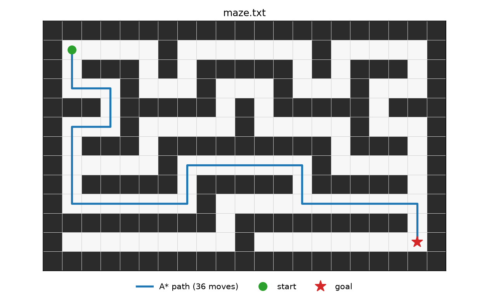

# Drone Autonomy Simulator


A 2D drone autonomy simulator built from scratch in **C++17**, with Python visualization.
The drone plans routes through grid and continuous obstacle maps with A* and RRT,
and later milestones add path following with a PID controller and reactive obstacle
avoidance.

The focus is clean, tested, interview-grade implementations of core robotics
algorithms rather than wrapping existing libraries.

## Results

A* finds the optimal 36-move route through a 21×13 maze (4-connected, unit cost):



## Features

- **Grid world:** occupancy grid loaded from a plain-text map format, with strict validation (ragged rows, unknown characters, missing or duplicate start/goal).
- **A\* path planning:** 4-connected search with a Manhattan heuristic, a binary-heap open set, lazy deletion of stale entries, and flat `g`/parent arrays for cache-friendly lookups.
- **Continuous world:** circular and axis-aligned rectangular obstacles in meters, loaded from a `.world` text format with line-numbered errors.
- **Collision checking:** the drone is a disc. Point and swept-segment checks against circles, rectangles and bounds are exact (closed-form, no sampling), so thin walls between two free points are never missed.
- **Drone dynamics:** point mass with max speed and max acceleration, integrated with semi-implicit Euler.
- **RRT:** sampling-based planning in continuous space with goal biasing, seeded and fully reproducible.
- **A\* vs RRT:** the continuous map is rasterized (obstacles inflated by the drone radius) so both planners run on the same world, then compared on path length, success rate, and runtime over many seeds.
- **CLI:** `plan_path` (A* on grid maps), `plan_rrt` (RRT, exports tree and path), `compare_planners` (benchmark table).
- **Visualization:** matplotlib scripts for grid worlds, an animated GIF of RRT tree growth, and an A*/RRT overlay.
- **Testing:** GoogleTest unit tests for parsing, collision geometry, dynamics, RRT invariants, and A*, including optimal-length checks against BFS.
- **CI:** GitHub Actions builds and runs the tests on every push.

## Build and run

Requirements: CMake ≥ 3.16, a C++17 compiler, Eigen 3, and Python 3 with matplotlib.
GoogleTest is fetched automatically by CMake.

```bash
# Dependencies
#   macOS:  brew install cmake eigen
#   Ubuntu: sudo apt install cmake libeigen3-dev
pip install matplotlib

# Build and test
cmake -S . -B build
cmake --build build -j
ctest --test-dir build --output-on-failure

# Plan a path and plot it
./build/plan_path maps/maze.txt build/path.csv
python3 viz/plot_world.py maps/maze.txt build/path.csv -o maze.png
```

`plan_path` exits with `0` if a path is found, `2` if there's no path, and `1` on bad input.

### Continuous planning (RRT)

```bash
# Plan with RRT and animate the tree growing
./build/plan_rrt maps/rooms.world build/rrt --seed 1
python3 viz/animate_rrt.py maps/rooms.world build/rrt -o rrt.gif --png rrt.png

# Compare A* (rasterized) and RRT over 20 seeds; use a Release build for timings
./build/compare_planners maps/rooms.world --runs 20 --out build/compare
python3 viz/plot_compare.py maps/rooms.world build/compare -o compare.png
```

`plan_rrt` options: `--seed`, `--step`, `--goal-tol`, `--goal-bias`, `--max-iters`.
`compare_planners` options: `--res` (A* cell size, m), `--runs`, `--max-iters`, `--out`.

### Map format

One character per cell. All rows have the same width, and blank lines are ignored.

| Char | Meaning             |
|------|---------------------|
| `.`  | free                |
| `#`  | obstacle            |
| `S`  | start (exactly one) |
| `G`  | goal (exactly one)  |

`x` is the column and `y` is the row, with row 0 at the top of the file.

### World format (`.world`)

Continuous maps in meters with `y` pointing up. One directive per line, and `#` starts a comment.

| Directive | Meaning |
|---|---|
| `bounds W H` | world is `[0, W] x [0, H]` (required) |
| `radius r` | drone radius, default `0` |
| `start x y` / `goal x y` | required, inside bounds |
| `circle cx cy r` | circular obstacle |
| `rect x0 y0 x1 y1` | axis-aligned rectangle, `x0 < x1`, `y0 < y1` |

## Project layout

```
include/drone/   public headers (grid, astar, world2d, collision, drone, rrt, rasterize)
src/             core library (drone_core)
apps/            CLI tools (plan_path, plan_rrt, compare_planners)
tests/           GoogleTest unit tests
maps/            sample worlds
viz/             Python plotting
docs/            images used in this README
```

## Roadmap

- [x] **Milestone 1:** grid world, map loading, A* planning, plotting, CI
- [ ] **Milestone 2:** continuous world, exact collision checking, drone dynamics, RRT vs A*, animated GIF
- [ ] **Milestone 3:** PID controller that flies the planned path, plus RRT* and path smoothing
- [ ] **Milestone 4:** reactive obstacle avoidance with dynamic obstacles and replanning
- [ ] **Milestone 5:** learned policy (RL) for navigation, benchmarked against the classical stack
